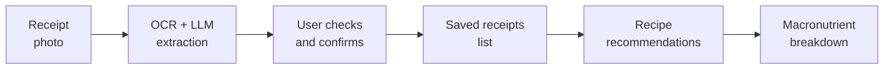
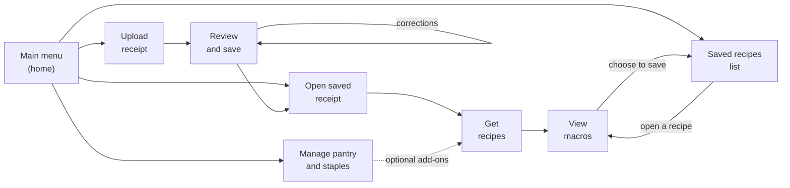
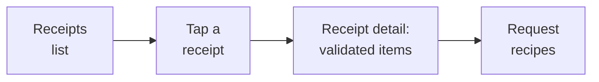

<!-- @slide Title -->

<!-- 5xl -->
# Nutritional Receipt Scanner and Recipe Generator

*Photograph a supermarket receipt, check it once, and get recipes and nutrition from what you bought.*

Author: Ángela Costa Trigo  
Neptun: IE2DPE  
Supervisor: Sári Dávid

---

<!-- @slide Problem -->

## Problem

<!-- @set-align left -->
<!-- @set-width 70% -->

- A supermarket receipt lists what was bought, but not **what to cook with it**.
- Receipt lines are often abbreviated, so reading them automatically can produce **wrong items or quantities**.
- Working out the **nutritional value** of a meal by hand is slow.
- People often already have other ingredients at home that could complete a recipe.

<!-- @callout question -->
> Can a receipt photo become reliable recipe ideas and nutritional information, with the user staying in control?

<!-- @note -->
> OCR and the LLM only suggest items. The user is the final validator, and nutrition is calculated by deterministic rules, not by the AI.

---

<!-- @slide Project idea -->

### From receipt to recipe

The app turns a supermarket receipt into saved ingredients, recipe recommendations, and a nutritional breakdown.

<!-- @note -->
> Recommendations always start from a saved, validated receipt. The pantry and basic staples can be added to a request, but never start one alone.

---

<!-- @slide Target users -->

## Target users

<!-- @set-align left -->
<!-- @set-width 70% -->

**People who shop at supermarkets and want meal ideas and nutritional information from their purchases.**

The user wants to:

- turn a receipt photo into a list of ingredients
- check and correct what the system read
- find a saved receipt again later
- get recipes that use what was just bought
- add pantry items and basic staples when useful
- see the macronutrients of a chosen recipe

<!-- @note -->
> One kind of user only: no administrator role, sharing, login method, or multi-user access model is planned at this stage.

---

<!-- @slide Planned scope -->

## Planned scope

<!-- @set-align left -->
<!-- @columns 2 4 -->

### In scope

- Receipt photo upload
- Extraction of items and quantities with OCR and an LLM
- User review, correction, and confirmation
- List of saved receipts; open one
- Recipe recommendations from a receipt's validated ingredients
- Optional pantry and basic staples as add-ons
- Macronutrient breakdown with deterministic calculations
- Manual pantry and staples management
- Explicit recipe saving and a list of saved recipes; open one
- Persistent storage of confirmed receipts, user-saved recipes, and pantry state

<!-- @col-break -->

### Out of scope

- Expiry dates for pantry items
- Automatic stock consumption
- Recommendations from the pantry or staples alone
- Picking loose ingredients to cook from
- Administrator role, sharing, multi-user access

<!-- @columns -->

<!-- @note -->
> Later extensions stay outside the initial flow so the core scanning, validation, and recommendation work is not diluted.

---

<!-- @slide Rules -->

### Rules behind the results

<!-- @set-align left -->
<!-- @set-width 70% -->

- Receipts are stored on **confirmation**, before they can be used.
- Recipes are stored **only when the user chooses to save them**.
- Recommendations start from a **saved, validated receipt**.
- Pantry and staples are **optional add-ons**, kept up to date by hand.
- Nutrition is calculated **deterministically**: the same inputs give the same result.
- Missing data is **never presented** as a confirmed, accurate breakdown.

<!-- @note -->
> Unchecked OCR/LLM output must not feed recipes or nutrition, and uncertainty has to stay visible to the user.

---

<!-- @slide User journeys -->

## Initial user journeys

Seven journeys cover the flow from photo to nutrition, plus the pantry and saved recipes. The saved recipes list can be opened at any time.

---

<!-- @slide Journey 1 -->

### Journey 1: Upload and scan a receipt

<!-- @set-align left -->
<!-- @set-width 70% -->

1. The user selects and uploads a photo of a receipt.
2. The application processes it with OCR and an LLM.
3. It suggests food items and quantities.
4. The suggestions appear as an **editable shopping list**.

<!-- @note -->
> If the image cannot be processed or no usable items are found, the app shows the problem and lets the user submit another photo.

---

<!-- @slide Journey 2 -->

### Journey 2: Review, correct, and save

<!-- @set-align left -->
<!-- @set-width 70% -->

1. The user checks the suggested items against the receipt.
2. The user corrects items or quantities where needed.
3. The user reviews fields the system could not read reliably.
4. The user **confirms** the list.
5. The receipt is saved to the receipts list.

<!-- @note -->
> If saving fails, the app says so instead of implying the receipt is saved.

---

<!-- @slide Journey 3 -->

### Journey 3: Open a saved receipt

<!-- @set-align left -->
<!-- @set-width 70% -->

1. The user opens the list of saved receipts.
2. The user taps a receipt.
3. The app shows its validated items and quantities.

<!-- @note -->
> With no saved receipts, the list says so and points to receipt upload. What the list shows for each receipt is still to be defined.

---

<!-- @slide Journey 4 -->

### Journey 4: Recipes from a receipt

<!-- @set-align left -->
<!-- @set-width 70% -->

1. From the open receipt, the app shows its ingredients as the base.
2. Optionally, the user switches on **pantry** and/or **enabled staples**.
3. The app matches the ingredients to recipe recommendations.
4. The user reviews the suggested recipes.
5. The user selects a recipe and the number of servings.

<!-- @note -->
> If no viable recipe exists, the app says so and the user can change the toggles or open another receipt.

---

<!-- @slide Journey 5 -->

### Journey 5: View the macronutrients

<!-- @set-align left -->
<!-- @set-width 70% -->

1. The user selects a recipe.
2. The app uses the recipe's ingredient quantities and nutritional data.
3. Deterministic calculations are applied.
4. The macronutrient breakdown is displayed.
5. Optionally, the user saves the viewed recipe. Recipes the user does not save are not stored.

<!-- @callout info -->
> If quantities or nutritional data are missing, the app shows the limitation instead of an unsupported result.

---

<!-- @slide Journey 6 -->

### Journey 6: Manage the pantry and staples

<!-- @set-align left -->
<!-- @set-width 70% -->

1. The user opens the pantry view at any time.
2. The user adds, edits, or removes pantry items and quantities by hand.
3. The user switches basic staples (for example oil, salt, pasta) on or off.
4. The app saves the pantry and staples state.

<!-- @note -->
> The app does not track expiry dates or reduce stock automatically. The user keeps the pantry up to date.

---

<!-- @slide Journey 7 -->

### Journey 7: View saved recipes

<!-- @set-align left -->
<!-- @set-width 70% -->

1. The user opens the saved recipes list at any time.
2. The list shows only recipes the user explicitly saved.
3. The user taps a recipe.
4. The app shows the recipe again with its macronutrient breakdown.

<!-- @note -->
> With no saved recipes, the list says so and points to the receipts list to get recommendations. If a saved recipe cannot be loaded, the app shows the failure instead of an empty recipe.

---

<!-- @slide Next steps -->

## Next steps

<!-- @set-align left -->
<!-- @set-width 70% -->

- Choose and prototype the **OCR and LLM** tools for extraction, and compare them.
- Decide where **recipes and nutritional values** come from, including their terms.
- Define how abbreviated receipt names map to ingredients, and which **units** are supported.
- Agree what makes a **recipe viable** for a receipt's ingredients.
- Define the nutrition **reporting basis** (whole recipe or portion) and what the receipts list shows.
- Agree the default list of basic staples.
- Decide whether reopening a saved recipe shows stored macronutrients or recalculates them.

