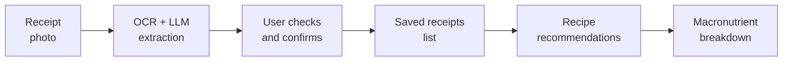
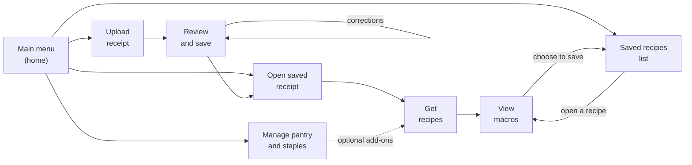
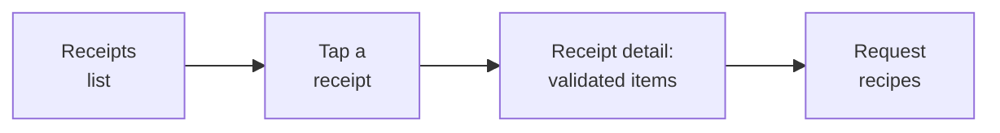

<!-- @slide Title -->

<!-- 5xl -->
# Nutritional Receipt Scanner and Recipe Generator

Author: Ángela Costa Trigo  
Neptun: IE2DPE  
Supervisor: Sári Dávid

---

<!-- @slide Problem -->

## Problem

<!-- @set-align left -->
<!-- @set-width 100% -->

- Receipt lists just what you bought
- Automatic reading of abbreviations can go wrong
- Nutritional calculation is slow
- People have more ingredients at home

<!-- @callout question -->
<!-- sm -->
> Can a receipt photo become reliable recipe ideas and nutritional information, with the user staying in control?

<!-- @note -->
> OCR and the LLM only suggest items. The user is the final validator, and nutrition is calculated by deterministic rules, not by the AI.

---

<!-- @slide Project idea -->

### From receipt to recipe

The app turns a supermarket receipt into saved ingredients, recipe recommendations, and a nutritional breakdown.

<!-- @note -->
> Recommendations always start from a saved, validated receipt. The pantry and basic staples can be added to a request, but never start one alone.

---

<!-- @slide Target users -->

## Target users

<!-- @set-align left -->
<!-- @set-width 100% -->

- **One actor: Application user**
	- Uploads receipts
	- Reviews, corrects, and confirms extracted items and quantities
	- Opens saved receipts
	- Manages the pantry and basic staples
	- Chooses a recipe
	- Views its nutritional breakdown

- No admin/multi-user features
- OCR/LLM as system components, not roles

---

<!-- @slide Planned scope -->

## Planned scope

<!-- @set-align left -->
<!-- @columns 2 4 -->

### In scope

<!-- sm -->
- Receipt photo upload
- Extraction with OCR and LLM
- List of saved receipts; open one
- Recipe recommendations
- Macronutrient breakdown
- 2 optional add-ons:
  - Pantry 
  - Basic staples

<!-- @col-break -->

### Out of scope

<!-- sm -->
- Expiry dates for pantry items
- Automatic stock consumption
- Recommendations from the pantry or staples alone
- Picking loose ingredients to cook from
- Administrator role, sharing, multi-user access

<!-- @columns -->

<!-- @note -->
> Later extensions stay outside the initial flow so the core scanning, validation, and recommendation work is not diluted.

---

<!-- @slide Rules -->

### Rules behind the results

<!-- @set-align left -->
<!-- @set-width 100% -->

**18 functional requirements → 4 ideas**

1. User as final validator
2. Suggestions start from a saved and validated receipt
3. Nutrition is calculated deterministically
4. Persistence has limits

 

**Priority:**

- Must: the core flow
- Should: add-ons and lists

---

<!-- @slide User journeys -->

## Initial user journeys

Four journeys cover the flow from photo to nutrition, plus the pantry and saved recipes. The saved recipes list can be opened at any time.

---

<!-- @slide Journey 1 -->

### Journey 1: Upload, review, and save a receipt

<!-- @set-align left -->
<!-- @columns 2 4 -->

**Main flow:**

1. The user uploads a photo of a receipt
2. The application processes it with OCR and an LLM
3. It suggests food items and quantities as an **editable shopping list**
4. User checks the suggestions against the receipt and corrects 
5. User reviews fields the system could not read reliably
6. User **confirms** list and receipt is saved

<!-- @col-break -->

**Requirements:**

- Image not processed: posible to take another photo
- Confirmed data as the basis for recommendations
- If saving fails: shows an error and the receipt is not saved
- Extracted outputs: suggestions, not final data
- Incomplete or unreadable field: points to the exact problem

<!-- @columns -->

---

<!-- @slide Journey 2 -->

### Journey 2: Open a saved receipt and get recipes

<!-- @set-align left -->
<!-- @columns 2 4 -->

**Main flow:**

1. User openS saved receipt and taps one
2. App shows the validated and user request recommendations
3. Optionally, U switches on add-ons
4. App matches ingredients to recipe
5. User selects one and nº of servings

<!-- @col-break -->

**Requirements:**

- No viable recipe: says so and change toggles/open other receipt
- Receipt never validated: never used
- No recommendations start from pantry, staples, or hand-picked ingredients

<!-- @columns -->

<!-- @note -->
> With no saved receipts, the list says so and points to receipt upload. What the list shows for each receipt is still to be defined

---

<!-- @slide Journey 3 -->

### Journey 3: View the macronutrients

<!-- @set-align left -->
<!-- @set-width 100% -->

**Main flow:**

1. The user selects a recipe.
2. The app uses the recipe's ingredient quantities and nutritional data.
3. Deterministic calculations are applied.
4. The macronutrient breakdown is displayed
5. Optionally: user saves the recipe. Recipes not saved are not stored.

**Requirements:**

- Acceptance test: Calculating twice with the same data gives the same results

<!-- @callout info -->
<!-- sm -->
> Data missing: shows limitation. NEVER unsupported results

---

<!-- @slide Journey 4 -->

### Journey 4: Pantry, staples, and saved recipes

<!-- @set-align left -->
<!-- @set-width 100% -->

**Main flow:**

1. The user opens the pantry view at any time.
2. The user adds, edits, or removes pantry items and quantities by hand.
3. The user switches basic staples (for example oil, salt, pasta) on or off.
4. The app saves the pantry and staples state.
5. User can open saved recipes (only those explicitly saved)
6. User taps a recipe and the app shows it with its macronutrient breakdown

**Risks:**

- Outdated pantry

---

<!-- @slide Technical points -->

### Two points to strengthen

<!-- @set-align left -->
<!-- @set-width 100% -->

**What is the LLM responsible for?**

OCR reads the text on the receipt. The LLM helps interpret abbreviated product descriptions, like MLK for milk. This is the proposed division of responsibilities, not a verified implementation yet.

 

**How do I know a recipe is viable?**

I still need to define this. I will investigate which ingredients are available, whether their quantities are enough, and whether missing ingredients are allowed. These are criteria to investigate, not matching rules I have decided yet.

---

<!-- @slide Next steps -->

## Next steps

<!-- @set-align left -->
<!-- @set-width 100% -->

- Choose OCR and LLM tools and compare
- Decide where values come from and terms
- Define:
  - How abbreviations in receipts map
  - The units supported
  - What makes a receipt viable
  - Basic staples

- Open design question: store the macronutrient breakdown or not
